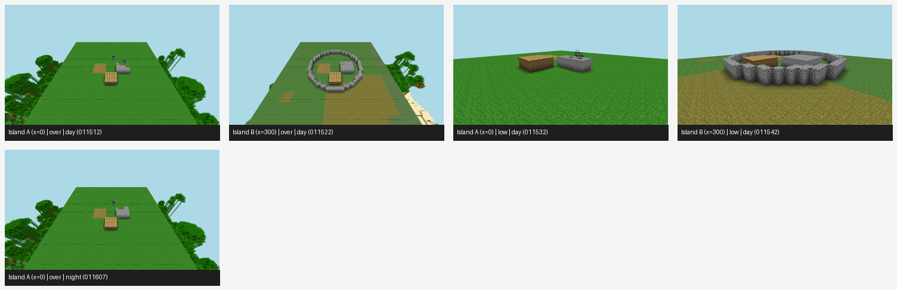

# Nobody Builds the Wall

Code, data and manuscript for **"Nobody Builds the Wall: Coordination, Not Ownership, Sustains Public Goods in
LLM Agent Societies"** (Quan Tran, Alexandre Tancrède, Anas Elghoudane, Pierre Duhoux), written for the
[Apart Swarm Alignment Sprint](https://apartresearch.com/sprints/swarm-alignment-2026), November 2026.

📄 **Paper:** [`nobody_builds_the_wall.pdf`](nobody_builds_the_wall.pdf) · LaTeX source in [`papers/C/`](papers/C)



## Question

100 identical LLM agents (Gemma 4 26B), all with the same personal goal (rest days plus owned goods), live on
islands where nightly mob attacks kill anyone outside a shared wall. The wall protects everyone but pays no
individual builder. Does the island's economic rule set decide who survives, and if so, is it ownership or
coordination that gets the wall built?

## Results

| Experiment | Setup | Finding |
|---|---|---|
| **E08** | 3 regimes × 100 agents × 5 seeds, 12 days | Laissez-faire: 0 walls, 5.0/100 alive. 20% tax + piece rate: 0.6 walls, 8.8 alive. Elected quota-setter: 142 walls, 0 mob deaths, 36.6 alive. Rest rates similar (0.24 vs 0.28). |
| **E12** | 2 islands × 24 agents, 52 weeks, elections, rule votes, migration | Capitalist island A went extinct by week 9–12 in every run, before the first vote; socialist island B survived the year (4–20 alive). |
| **E14** | Ownership (private / common) × coordination (none / coordinator / planner), 60 agents, 10 seeds, plus a loophole that drains the wall | Uncoordinated common store games the loophole most (hack rate 0.59) and builds 0 walls. An elected coordinator cuts loophole use in every seed and restores wall building. |
| **E09, E12-MC, E14-MC** | Same islands with one Mineflayer bot per agent on a Paper 1.21.4 server | E09: both capitalist islands built 0 walls and lost all 50 bots; the socialist island built 70 walls, lost none to zombies, kept 35 alive. |

Every number in the paper traces to a file under [`results/`](results).

## Repository layout

```
src/swarm/          simulation library
  islands.py          E08/E13/E14 island economies (text world)
  market.py           food-for-coins call auction
  year.py             E12 one-year, two-island run
  mc_islands.py       bridge to the Minecraft controller (E09, E12-MC, E14-MC)
  llm.py              model backends: mock, anthropic, openai-compatible, adaption
  commons.py, scarcity.py, barrier.py   scarcity and ledger-hacking study
  diagnose.py, tamper.py, sim.py        witness-free tamper attribution (paper A)
experiments/EXX_*/  pre-registration (prereg.md) and runner per experiment
results/EXX/        JSONL outputs cited by the paper
papers/C/           this paper: paper.tex, figure scripts, figures, Minecraft screenshots
papers/scarcity/    companion study (draft)
papers/A/           tamper attribution study (draft)
notebook/LAB.md     dated lab notebook kept during the sprint
tests/              pytest suite
```

## Other studies in this repository

| Folder | Study | Lead | Experiments |
|---|---|---|---|
| [`papers/scarcity/`](papers/scarcity) | *When Scarcity Breeds Subversion: Ledger Hacking and Its Defenses in Mixed-Motive Agent Economies* (draft). Source of the `ledger_sync` loophole used in E14. | Quan Tran | E08_scarcity_synthetic, E09_scarcity_llm, E09b_cbf_governance |
| [`papers/A/`](papers/A) | *When the Suspects Write the Logs: Witness-Free Tamper Attribution for Agent Swarms* (draft) | Quan Tran, Anas Elghoudane | E01, E02, E02b |
| — | Police overreach, spy thriller on [Concordia](https://github.com/google-deepmind/concordia), village economy | Anas Elghoudane | E04–E07 |

## Contributors

| Name | GitHub | Work |
|---|---|---|
| Quan Tran | [@benhoangquan](https://github.com/benhoangquan) | E02 LLM liars, scarcity and ledger-hacking study, defenses |
| Alexandre Tancrède | [@Alex64-1149](https://github.com/Alex64-1149) | E12 one-year runs |
| Anas Elghoudane | [@Nas01010101](https://github.com/Nas01010101) | island simulator, E08–E14, Minecraft bridge, paper |
| Pierre Duhoux | [@Pierredhx](https://github.com/Pierredhx) | E09 and E10 text-world runs |

## Setup

```bash
uv sync --group dev --extra sim --extra llm --extra plot
uv run --group dev --extra sim --extra llm pytest -q   # offline, mock backend
```

Model backend is chosen by environment variable:

| `SWARM_BACKEND` | Needs |
|---|---|
| `mock` (default in tests) | nothing |
| `adaption` (default for E08/E09 runners) | `ADAPTION_API_KEY` |
| `openai` | `OPENAI_BASE_URL`, `SWARM_MODEL` (any OpenAI-compatible server, e.g. vLLM via `experiments/E14_master/modal_vllm.py`) |
| `anthropic` | `ANTHROPIC_API_KEY` |

The Minecraft runs also need Node.js, a Paper 1.21.4 server, and
`npm install mineflayer vec3 prismarine-viewer puppeteer`.

## Reproducing the paper

```bash
# E08: three regimes, 100 agents, 5 seeds
uv run --extra sim python experiments/E08_islands/run.py --model gemma-4-26b-a4b-it \
  --islands capitalist,capitalist_tax,socialist --n 100 --days 12 --seeds 5 --tag main_gemma

# E14: six neutral-worded economies with the loophole, 10 seeds
uv run --extra sim --extra llm python experiments/E08_islands/run.py --model gemma-4-26b-a4b-it \
  --islands capitalist,socialist,directed,commons,capitalist_tax,planned --neutral --loophole \
  --n 60 --days 12 --seeds 10 --tag e14
uv run --extra sim python experiments/E14_master/analyze.py

# E12: one year, fixed vs open rules
uv run --extra sim python experiments/E12_year/run.py --model gemma-4-26b-a4b-it \
  --arms fixed,open --n 24 --weeks 52 --seeds 1 --tag main

# Figures and PDF
uv run --extra sim python papers/C/figs.py
pdflatex -output-directory=papers/C papers/C/paper.tex
```

The Minecraft commands (E09 calibration, E12-MC, E14-MC) are listed in the paper's Reproducibility section.

## Citation

```bibtex
@misc{tran2026nobody,
  title  = {Nobody Builds the Wall: Coordination, Not Ownership, Sustains Public Goods in LLM Agent Societies},
  author = {Tran, Quan and Tancr{\`e}de, Alexandre and Elghoudane, Anas and Duhoux, Pierre},
  year   = {2026},
  note   = {Apart Swarm Alignment Sprint},
  url    = {https://github.com/Nas01010101/swarm-alignment-2026}
}
```

## License

MIT. The E04 scenario design is adapted from "Scenario B: Stereotypes and Police Overreach", a
specification from the Mila multi-agent oversight project. The island setup adapts jjkay03's
[200-player Minecraft experiment](https://www.youtube.com/watch?v=LOrEp0rAHDg).
